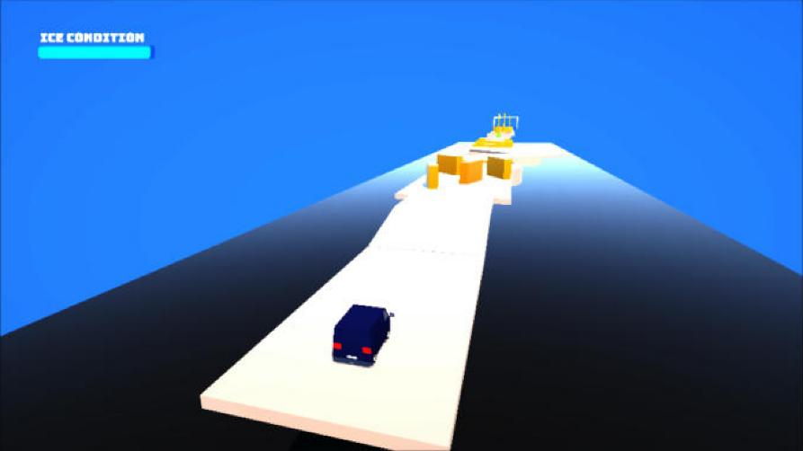

# ICEMAN: Greybox Prototype

A physics-based vehicle obstacle game built in **Unity 6**. You drive a delivery van through the Frozen Delivery Test Facility carrying a fragile block of ice, and every second counts: the ice melts over time, and hard landings and hammer hits chip away at it. Get to the finish line fast, but not so recklessly that there is nothing left to deliver.

This repository contains the **greybox prototype level**, built with ProBuilder to test the core mechanics, pacing and level flow before any final art pass.



## Core loop

- **Ice Condition** starts at 100% and melts steadily during the run.
- **Hammers** swing across the track and damage the ice based on impact strength.
- **Landings** above a safe impact speed cause extra damage that scales with how hard you hit.
- **Boost ramps** push the van forward, trading control for speed.
- Falling off the course or running out of ice **fails the run**.
- Reaching the finish shows the **percentage of ice delivered** and a detailed results screen.

## Level sections

The prototype level is a sequence of test sections, each built around one challenge:

| Section | What it tests |
| --- | --- |
| Barrier Section | Steering through tight gaps |
| Sweeper Section | Timing around rotating sweepers |
| Recovery Section | A breather to stabilize after hazards |
| Hammer Section | Swinging pendulum hammers |
| Moving Platform Section | Jump timing onto moving platforms |
| Boost Ramps | Speed and landing control |
| Mixed Section | Combined hazards before the finish |

## Controls

| Action | Keyboard | Gamepad |
| --- | --- | --- |
| Accelerate / Reverse | W / S | Right Trigger / Left Trigger |
| Steer | A / D | Left Stick |
| Hop (double hop) | Space | A (Xbox) / Cross (PlayStation) |
| Back / Quit | Esc | B (Xbox) / Circle (PlayStation) |

The van can steer slightly in the air and rights itself automatically on the ground.

## Results screen

At the end of a run the game breaks down how the ice was lost:

- Run time
- Melt, hammer and landing damage
- Number of hammer hits and hardest landing
- Total ice lost and final ice delivered (%)

## Project structure

```
Assets/
  Scenes/          MainMenu, Prototype_Level
  Scripts/
    Player/        PlayerCarController, IceCondition, LandingDamage, RunStats
    Obstacles/     HammerController, HammerDamage, PendulumController,
                   SweeperController, MovingPlatform, BoostPad
    Game/          CameraFollow, FinishTrigger, OutOfBounds, EscapeToQuit
    UI/            MainMenuController, ResultsUI, GameUIController, ...
  Prefabs/  Materials/  Audio/  Fonts/  UI/  VehicleModels/
Packages/          Unity package manifest
ProjectSettings/   Unity project settings
```

## Getting started

1. Install **Unity 6000.3.7f1** (Unity 6.3 LTS) through Unity Hub.
2. Clone this repository:
   ```
   git clone https://github.com/lordbaki/IceMan_Greybox.git
   ```
3. In Unity Hub choose **Add > Add project from disk** and select the cloned folder.
4. Open `Assets/Scenes/MainMenu.unity` and press **Play**.

The first open takes a few minutes while Unity rebuilds the `Library` folder.

## Built with

- Unity 6 (6000.3.7f1), Universal Render Pipeline
- ProBuilder for greyboxing
- Unity Input System (keyboard and gamepad)
- TextMesh Pro

## Credits

- Design and development: **Ali Hashemi**
- Developed as the term project for DATT 3300 Game Mechanics, York University
- Music: "Starting Line" by LudoLoon Studio, "Chiptuna Sandwich"
- Font: Bungee by David Jonathan Ross (SIL Open Font License)

Third-party music and fonts remain the property of their respective creators and are included only to run the prototype.
